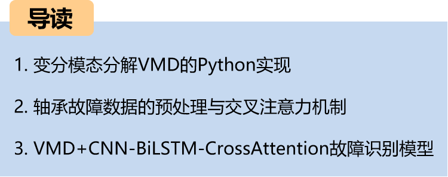
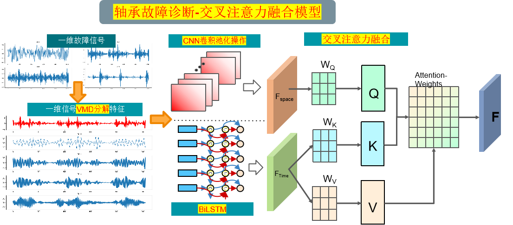
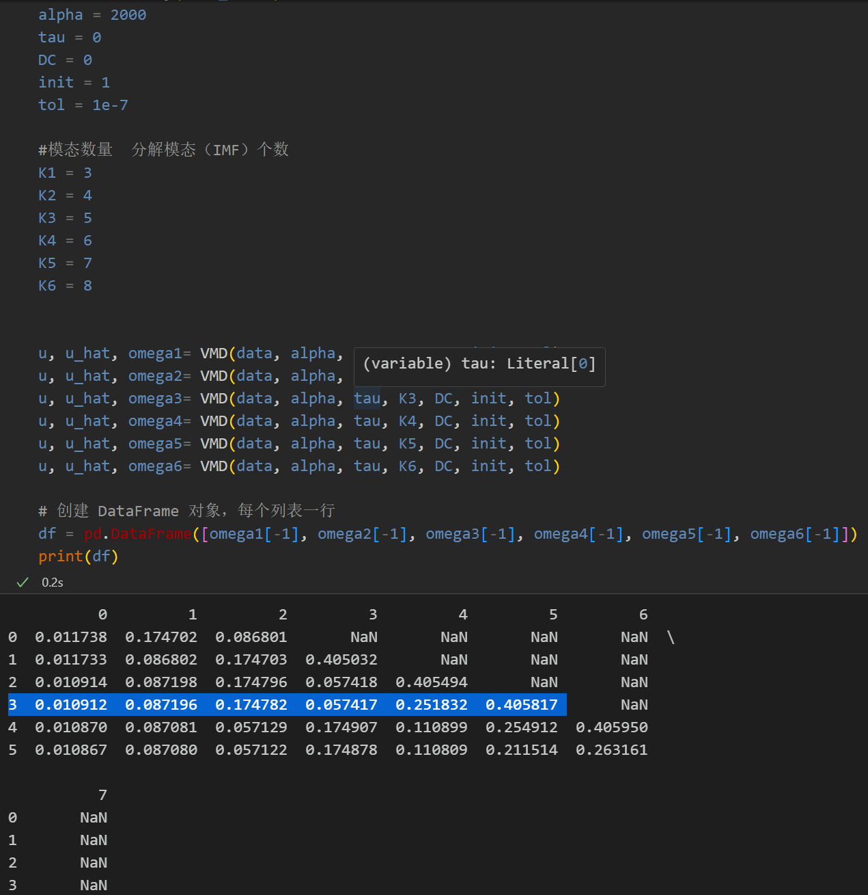
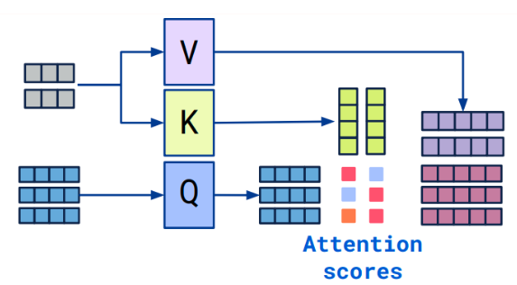
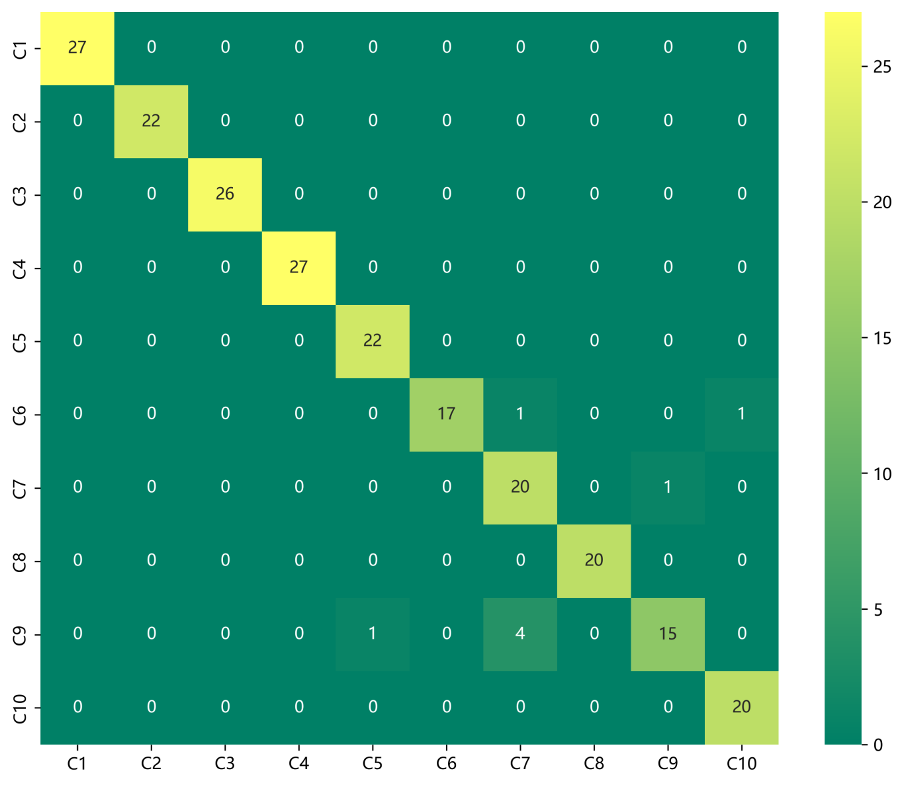
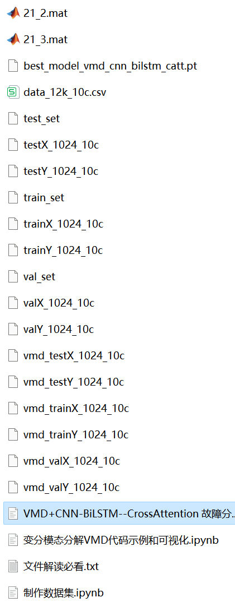
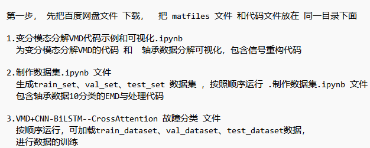

# Bearing Fault Identification: A VMD+CNN-BiLSTM-CrossAttention Fault Detection Model Based on Cross Attention Feature Fusion

Recommendation - Family Pack, higher cost-performance!!!! Thesis innovation!!! 
The cross-attention mechanism can model the degree of correlation between different features. It extracts important features for model recognition from fault signal frequency domain and time domain characteristics, with significant effects. 
This includes a complete bearing fault dataset, as well as fault signal datasets, classification data, and label sets that have been generated and prepared. All corresponding codes can be run, along with examples of Fast Fourier Transform (FFT). 
With 50 epochs, an accuracy rate of 100%, the VMD+CNN-BiLSTM-CrossAttention network achieves significant results in classification. The model is capable of fully extracting spatial and temporal features as well as frequency domain features of bearing fault signals, with fast convergence speed and superior performance. To date, it is the most accurate method among previous articles. Innovation also exists!!! 
Includes code for data preprocessing and the VMD+CNN-BiLSTM-CrossAttention classification code. 
Environment: Python 3.9 
Innovation point: Using the cross-attention mechanism to fuse models! 
Preface 
\tThis article is based on the bearing data from Case Western Reserve University (CWRU), introducing the variational mode decomposition (VMD) and data preprocessing, and finally classifying fault data through a spatial-temporal feature fusion model based on the cross-attention CNN-BiLSTM-CrossAttention using Python. For a detailed introduction to the bearing data from Case Western Reserve University, please refer to the following article: 
Python-Case Western Reserve University (CWRU) Bearing Data Interpretation and Classification Processing 
Overall Model Structure 
\tThe overall structure of the model is as follows: 
\tVMD Decomposition:  
\tInput: Bearing vibration signal  
\tOperation: Through VMD technology, the original signal is decomposed into multiple intrinsic mode functions (IMF)  
\tOutput: Each IMF represents vibration components within different frequency ranges  
\tCNN Spatial Feature Extraction:  
\tInput: IMFs obtained from VMD decomposition
1. Operation: Convolution and pooling operations are performed on each IMF to extract spatial features.
Output: The feature representation after convolutional pooling, used to capture vibrational spatial features at different frequencies.

2. BiLSTM Time Series Feature Extraction:
Input: IMFs obtained from VMD decomposition.
Operation: A bidirectional LSTM network learns the sequence information, focusing on important time series features.
Output: The time series feature representation processed by BiLSTM, with better fault signal time series modeling capability.

3. Cross Attention Mechanism Feature Fusion:
Input: Spatial features extracted by CNN and time series features extracted by BiLSTM.
Cross Attention Mechanism: Use a cross attention mechanism to fuse features in both time and frequency domains. By calculating attention weights, the model can focus more on important features, enhancing model performance and generalization capabilities.

4. Variational Mode Decomposition (VMD) Python Example:
Step 1, Install and download the VMD package in Python:
# Download
pip install vmdpy  
# Import
from vmdpy import VMD  
\tStep 2: Import relevant packages for decomposition  
import numpy as np  
import matplotlib.pyplot as plt  
from vmdpy import VMD  
# -----Test Signals and Their Parameters--start-------------
t = np.linspace(0, 1, 1000)  
signal = np.sin(2 * np.pi * 5 * t) + np.sin(2 * np.pi * 20 * t)  
T = len(signal)  
fs = 1/T  
t = np.arange(1,T+1)/T  
# alpha penalty coefficient; the bandwidth limitation experience value is 1.5-2.0 times of the sampling point length.
# The smaller the penalty coefficient, the larger the bandwidth of each IMF component. Excessive bandwidth can lead to some components containing the signals of other components.
alpha = 2000  
#Noise Tolerance, generally taken as 0, that is to allow the reconstructed signal and the original signal have differences.
tau = 0  
#Modality Count IMF Decomposition Count
K = 5  
#DC Synthetic Signal: If there is no constant, the value is 0; if there is a constant, its value is 1.
# DC If 0, then let the first IMF be a DC component/trend vector.
DC = 0  
# Initialize the ω value, when initialized to 1, generates random numbers uniformly distributed.
# init refers to initializing the center frequency of each IMF. When initialized as 1, it performs uniform initialization.
init = 1  
#Constants for controlling the size of control errors, determining precision and iteration count.
tol = 1e-7  
# -----Test Signals and Their Parameters--end----------
# Apply VMD  
# Output U represents the individual IMF components, u_hat denotes the spectrum of each IMF, and omega is the center frequency of each IMF.
u, u_hat, omega= VMD(signal, alpha, tau, K, DC, init, tol)  
# Obtain the numerical value of the center frequency
print(omega[-1])  
# Plot the original signal and decomposed modes  
plt.figure(figsize=(15,10))  
plt.subplot(K+1, 1, 1)  
plt.plot(t, signal, 'r')  
plt.title("Original Signal")
for num in range(K):  
plt.subplot(K+1, 1, num+2)  
plt.plot(t, u[num,:])  
plt.title("IMF "+str(num+1))  
plt.show()  
2. Data Preprocessing for Bearing Faults
2.1 Import Data
Refer to the previous article for preprocessing of fault classification 10, and the Case Western Reserve University bearing data set: Classification 10 dataset.
\ttrain_set, val_set, test_set are all divided into training set, validation set and test set according to the ratio of 7:2:1, and finally save the data.
The above figure is the form of data reading and preprocessing ideas.
2.2 Failure VMD Decomposition and Visualization
Step 1: Mode selection
Observe the center frequency under different K values, select the K value; Starting from K=4, there are modes with similar center frequencies, indicating overdecomposition. Therefore, the number of modes K is set to 4.
Step 2: Visualization of Decomposition and Breakdown of Faulted VMD
\t2.3 Preprocessing of VMD Decomposition for Fault Data
3 Cross Attention Mechanism
\t3.1 Cross Attention Concept
\tThe two sequences must have the same dimensions.
\tThe two sequences can be different patterns (such as: text, sound, image).
A sequence as input defines the output sequence length, and another sequence provides the input K&V.
3.2 Cross-attention Algorithm
The algorithm involves two sequences, S1 and S2.
Calculate K and V for S1.
Calculate Q for S2.
Compute the attention matrix based on K and Q.
Apply V to the attention matrix.
The output sequence length should be consistent with S2.
During the fusion process, we use the spatial features obtained through CNN convolutional pooling as the query sequence, and the time series features output by BiLSTM as the key-value pair sequence. By calculating the attention weights between the query sequence and the key-value pair sequence, we can model the degree of association between different features.
3. Classification of Bearing Fault Diagnosis Based on VMD+CNN-BiLSTM-CrossAttention
Below is a classification method using VMD decomposition of bearing fault data. First, the components are extracted from the decomposition through CNN convolutional pooling to extract spatial features, then simultaneously enter the BiLSTM layer to extract time series features. The cross-attention mechanism is used to fuse both time domain and frequency domain features, enhancing the features, and achieving the classification method of CNN-BiLSTM-CrossAttention signals.
3.1 Define the VMD+CNN-BiLSTM-CrossAttention classification network model.
3.2 Set parameters and train the model.
With 50 epochs, the accuracy is nearly 98%. The VMD+CNN-BiLSTM-CrossAttention network achieves significant classification results, fully extracting the spatial and time series features of bearing fault signals. The convergence speed is fast, the performance is excellent, the accuracy is high, and the cross-attention mechanism models the degree of association between different features. It effectively extracts important features from the frequency and time domain characteristics of the fault signal, showing noticeable effects. Further tuning of parameters can further improve the classification accuracy.
Note: Adjust parameters appropriately:
- You may increase the number of CNN layers and the dimensionality of the hidden layer, and adjust the learning rate slightly.
Adjust the number of layers and dimensions in the BiLSTM layer, increase more epochs (note to prevent overfitting)
Change the shape of one-dimensional signal stacking (set appropriate length and dimension)
3.3 Model evaluation
Accuracy, Precision, Recall, F1 Score
Fault classification confusion matrix:
\n        \n

## Images

<!-- PAYMENT_BLOCK -->

## Get this dataset

- Payment link (Stripe): [Buy now](https://buy.stripe.com/3cs8yP7sY87d0vu9AB)
- Payment QR code: 

<!-- /PAYMENT_BLOCK -->
